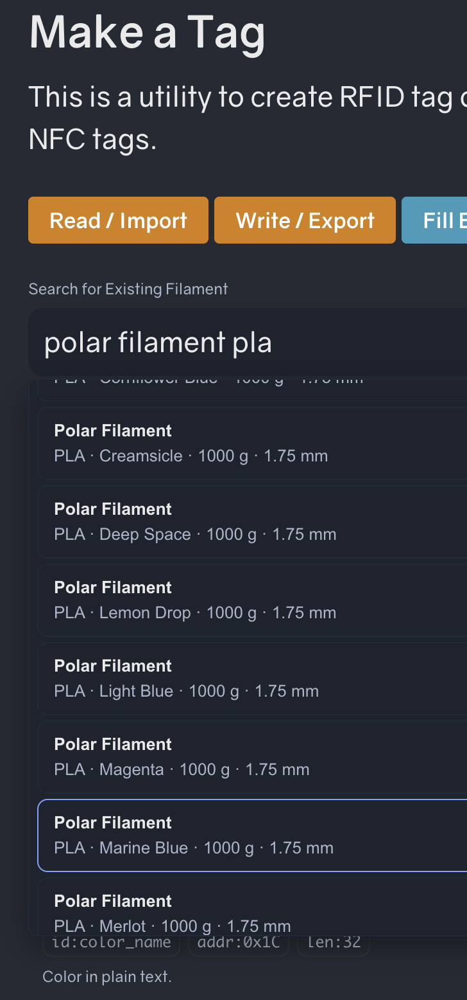
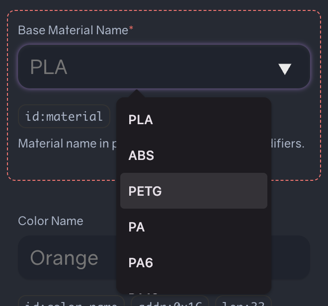
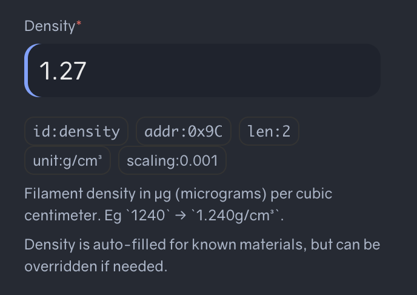

We're excited to introduce filament lookup in the OpenTag3D Make a Tag page!

When tagging filament from existing brands, writing tag data has become much easier.  Rather than enter every detail by hand, you can now search for filament by the manufacturer, material and/or color name. The OpenTag3D fields are then populated accordingly, allowing you to write the data to a tag in seconds.

*Search for a filament and select a result to fill in its available details.*

All of the data can be modified after it's been loaded.

## Powered by community data

Filament search results come from [SpoolmanDB](https://donkie.github.io/SpoolmanDB/), a community-maintained filament database. SpoolmanDB is constantly updated with new filaments.

Not able to find your filament?  That's okay!  You can file an issue on SpoolmanDB's GitHub repository, or fill in all the details on the make page manually.

## Density is autofilled by default

Continuing the goal of making tag creation easier, the density field is also autofilled with the appropriate value by default.

## Give it a try

Head to [Make a Tag](/make.html), search for a filament, and select a result to get started!
