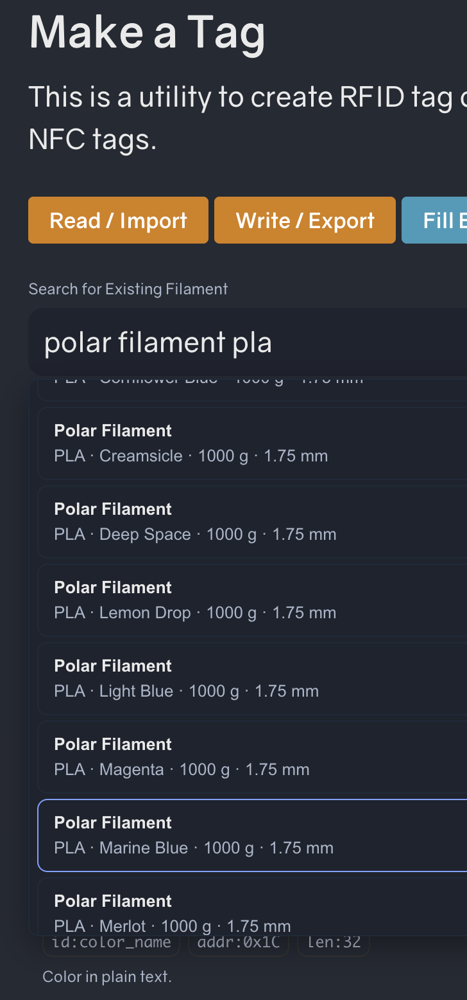
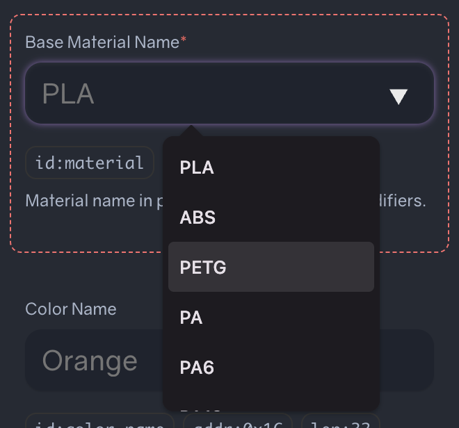
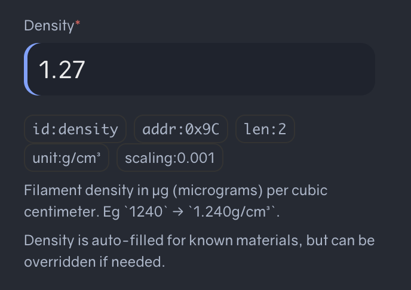

We're excited to introduce filament lookup in the OpenTag3D Make a Tag page!

When tagging filament from existing brands, writing tag data has become much easier. Rather than enter every detail by hand, you can now search for filament by the brand, material and/or color name. The OpenTag3D fields are then populated accordingly, allowing you to write the data to a tag in seconds.

_Search for a filament and select a result to fill in its available details._

All of the data can be modified after it's been loaded.

## Powered by community data

Filament search results come from [SpoolmanDB-Community](https://icezaza2543.github.io/SpoolmanDB-Community/), an independently maintained community catalog. Product codes, barcodes, and material fill metadata are added to matching OpenTag3D fields when available.

Not able to find your filament? That's okay! You can file an issue on [SpoolmanDB-Community's GitHub repository](https://github.com/Icezaza2543/SpoolmanDB-Community), or fill in all the details on the make page manually.

## Density is autofilled by default

Continuing the goal of making tag creation easier, the density field is also autofilled with the appropriate value by default.

## Give it a try

Head to [Make a Tag](/make.html), search for a filament, and select a result to get started!

---

Update November 17, 2026:

The density autofill now uses material modifiers when available! The density data is sourced from [SpoolmanDB-Community](https://icezaza2543.github.io/SpoolmanDB-Community/materials.json).

---

Update ???:

We have switched from the upstream SpoolmanDB that is maintained by the Spoolman author to a compatible community-maintained database, [SpoolmanDB-Community](https://icezaza2543.github.io/SpoolmanDB-Community/). This change was made as SpoolmanDB-Community has a much larger library of filaments, as well as more information that can be stored on OpenTag3D tags.
